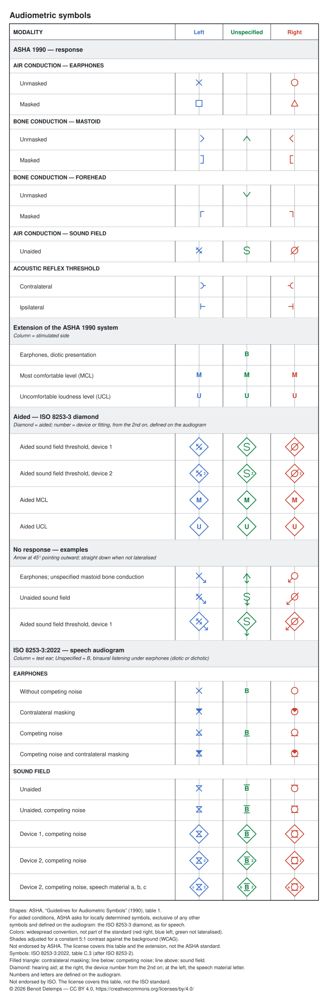

# otoicons

Symbols for pure-tone measurements on an audiogram: the ASHA symbols (1990),
completed by an extension for the measurements the standard does not cover;
and the speech audiogram symbols of ISO 8253-3:2022. No dependencies.

The table is available in English, French, German, Spanish, Italian and
Portuguese, on a light and on a black background:
`docs/symbols.<locale>[.dark].svg`.



## Features

1. **ASHA compliant.** Every symbol of the ASHA "Guidelines for Audiometric
   Symbols" (1990): air and bone conduction, masked and unmasked, sound field,
   acoustic reflexes, with their offset from the frequency line and the
   no-response arrow.
2. **Completes ASHA the way ASHA asks.** The standard leaves aided conditions
   to "locally determined symbols", distinct from all others and defined on
   the audiogram. The extension takes them from ISO 8253-3, adds MCL, UCL and
   diotic presentation, and documents them in every table.
3. **One aided rule.** On the pure-tone and the speech audiogram alike, a
   diamond around the symbol means aided; from the second device or fitting
   on (another aid, a CROS, a new setting…), its number stands at the right,
   defined in the legend.
4. **One colour, one rule.** Colour always means the stimulated side — red
   right, blue left, green not lateralised — aided or not, so it reads the
   same everywhere on the audiogram.
5. **Constant contrast.** Each colour is tuned to the same 5:1 WCAG contrast
   against its background: no side outweighs another, and legibility does
   not depend on the theme. A test guards the ratio.
6. **Light and dark themes.** Identical shapes, a palette for each background.
7. **Language-free symbols, translated tables.** No symbol depends on the
   language; the illustrative tables come in English, French, German,
   Spanish, Italian and Portuguese.
8. **Vector and raster.** SVG for any size, PNG for tools that need images;
   symbols and tables alike.
9. **Ready to place.** Each file is centred on the measurement point, on a
   transparent background; `manifest.json` describes every file for
   automated use. At runtime, `symbolSvg` draws the same symbols from the
   measurement itself.
10. **Speech audiometry.** The speech audiogram symbols of ISO 8253-3:2022
    (table C.3): right, left and binaural, contralateral masking, competing
    noise, sound field and hearing aids. They share their base shapes and
    colours with the pure-tone symbols.
11. **Open.** Code under Apache 2.0, symbol files and tables under CC BY 4.0.

## Installation

```sh
npm install otoicons
```

The symbol files (SVG and PNG, light and dark themes) and the illustrative
tables in six locales are attached to every
[GitHub release](https://github.com/Jerboas86/otoicons/releases) as
`otoicons-bundle-<version>.zip`.

## Usage

```ts
import { audiogramSymbol } from "otoicons";

audiogramSymbol({
  measure: "threshold",
  transducer: "sound_field",
  ear: null,
  masked: false,
  no_response: true,
  aided: { right: "hearing_aid", left: null },
  device: 2,
});
// → { kind: "asha", shape: "sf_unspecified", ear: null, color: "green",
//     no_response_arrow: "down", aided: true, device: 2 }
```

The function only reads the axes that determine the symbol (`SymbolAxes`); a
measurement carrying other data can be passed as is.

- `ashaSymbol`: the ASHA symbol alone, `null` when the standard defines none.
- `ASHA_SHAPES`, `ASHA_ARROW_ANCHORS`, `noResponseArrowPath`: SVG paths of
  the shapes and of the no-response arrows.
- `AIDED_DIAMOND`: SVG path of the aided diamond, shared by pure tones and
  speech.
- `speechSymbol`: symbol of a point on the speech audiogram (`SpeechAxes`),
  `null` for the conditions ISO 8253-3 excludes (binaural masking, aided
  under earphones).
- `symbolSvg`: SVG element of a symbol, pure-tone or speech, centred on the
  measurement point, in the `light` or `dark` theme.

```ts
import { speechSymbol, symbolSvg } from "otoicons";

symbolSvg(
  speechSymbol({
    transducer: "sound_field",
    ear: "left",
    masked: false,
    competing_noise: true,
    aided: { right: "hearing_aid", left: "hearing_aid" },
    device: 2,
    material: "a",
  })!,
);
// → X with lines above and below, in a diamond, "a" at the left, "2" at the right
```

More in [`examples/`](examples/): a complete audiogram, an aided legend with
device numbers, a speech audiogram, and a live symbol picker in the browser.

## Principles

- **ASHA symbols.** Shapes from table 1 of "Guidelines for Audiometric
  Symbols" (ASHA, 1990), including their offset from the frequency line.
- **Extension.** ASHA defines no symbol for aided measurements and asks for
  "locally determined symbols", exclusive of any other symbols and defined on
  the audiogram. It does not cover MCL, UCL nor diotic presentation under
  earphones either. The extension uses letters, `M` (MCL), `U` (UCL) and `B`
  (diotic presentation, the binaural `B` of ISO 8253-3).
- **Aided.** The ISO 8253-3 marking, on both audiograms: the symbol of the
  measurement in a diamond (an aided threshold is the ASHA sound-field symbol
  of the ear: `S`, `Ø` or `*`); from the second device or fitting on, its
  number at the right. Numbers are defined in the audiogram legend; the
  symbol does not tell which side is aided. Aided under earphones has no
  symbol.
- **Colour.** Widespread convention, not part of the standard: red right,
  blue left, green when not lateralised. It always represents the stimulated
  side, aided or not. Contrast is constant, not colour: each hue is adjusted
  in lightness for a 5:1 WCAG contrast against the background, in the light
  and dark themes alike (`SIDE_COLORS`).
- **No response.** Arrow attached to the bottom of the symbol, 45° outward;
  straight down when not lateralised. On an aided symbol, it leaves from the
  diamond.
- **Speech audiogram.** ISO 8253-3:2022, clause 14 and table C.3: `O` right
  ear, `X` left ear, `B` binaural under earphones (diotic or dichotic), drawn
  as the pure-tone `O`, `X` and diotic `B`. Modifiers: filled triangle on top,
  contralateral masking; line below, competing noise; line above, sound
  field; diamond, hearing aid, with the device number from the second device
  at the right, as for pure tones; speech material letter at the left. Numbers and letters are
  defined on the audiogram. Unlike ASHA (△, □), masking is a filled triangle,
  as the standard requires. Bone-conducted speech, which no standard covers,
  has no symbol.

## Limitations

- The shapes were traced from a low-resolution reproduction of the ASHA
  table.
- The speech symbols were traced from the identical Russian adoption,
  GOST R ISO 8253-3—2024 (annex C, table C.3), not from the ISO original.
- The table translations have not been reviewed by native-speaking
  audiologists.

## Development

```sh
pnpm install
pnpm test        # unit tests
pnpm build       # dist/: JavaScript and type declarations
pnpm bundle      # docs/ tables and bundle/
```

Pushing a `v<version>` tag publishes the package to npm and attaches the
bundle to a GitHub release (`.github/workflows/release.yml`).

## Documentation and bundle

- `pnpm doc` regenerates the tables `docs/symbols.<locale>.svg`, their
  extended versions with the kit features (`.extended.svg`) and the
  black-background versions of both (`.dark.svg`), in the six locales.
- `pnpm bundle` regenerates the tables, then builds `bundle/`: one file per
  symbol, with and without the no-response arrow, unaided and aided
  (devices 1 to 4), in the `light` and `dark` themes, as SVG and PNG. At the root: a README describing
  how to use the bundle, the illustrative tables and `manifest.json`.
  - `bundle/README.md`, `bundle/manifest.json`
  - `bundle/symbols.<locale>[.extended][.dark].{svg,png}`
  - `bundle/<theme>/<name>.{svg,png}`

`symbolSvg` produces the same rendering at runtime, to draw an audiogram.

## Sources

- ASHA, [Guidelines for Audiometric Symbols](https://www.asha.org/policy/gl1990-00006/), 1990.
- ISO 8253-3:2022, Acoustics — Audiometric test methods — Part 3: Speech
  audiometry, clause 14 and annex C (via GOST R ISO 8253-3—2024).

## License

The source code, including the SVG paths in `lib/` and the scripts in
`scripts/`, is released under the [Apache 2.0 license](LICENSE).

The tables in `docs/` and the files of the bundle (SVG and PNG) are released
under [CC BY 4.0](https://creativecommons.org/licenses/by/4.0/). Every SVG file
names its author and license.

These licenses cover the presentation of the tables and the extension
(letters, aided marking, conventions). They do not cover the symbols nor the
text of the ASHA guidelines or of ISO 8253-3, cited as the sources. This work
is neither published nor endorsed by ASHA or ISO, and the license grants no
right to use their names to present software as approved or certified by
them.
